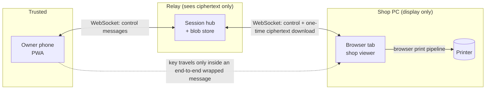
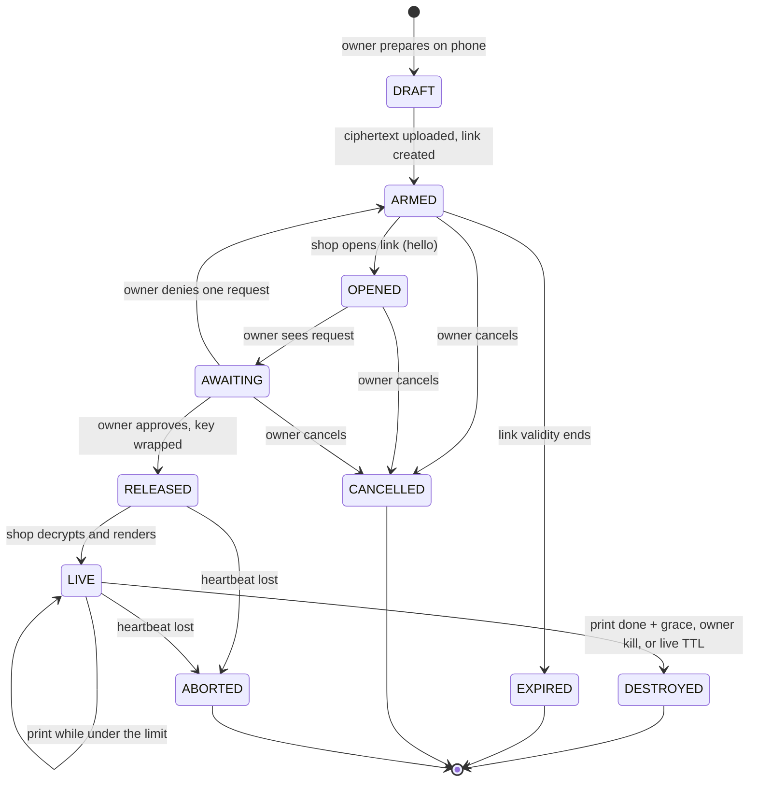
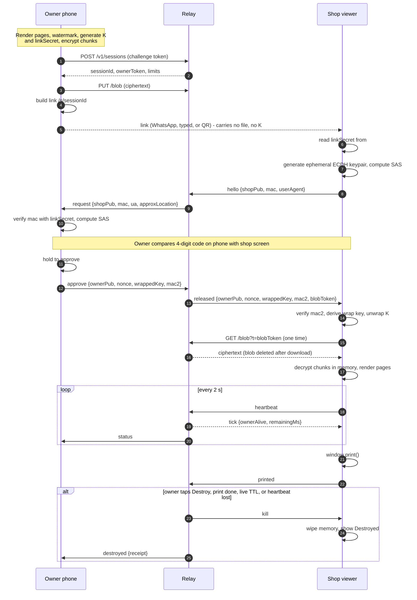

# Despawn: Architecture

Version 0.1 (draft). Read REQUIREMENTS.md first. Requirement IDs (SEC-03, VWR-06, and so on) are referenced throughout.

## 1. Design principles

| # | Principle | Consequence |
|---|---|---|
| P1 | **Presence over possession.** The shop never holds anything that works without the owner's live approval. | The link carries no file key. Decryption needs a live handshake with the owner's phone. |
| P2 | **The owner's phone is the only trusted device.** | All conversion, masking, watermarking and key generation happen there. |
| P3 | **The shop browser is a dumb, untrusted display.** | It runs a tiny viewer, holds data in memory for about a minute, and is treated as hostile. |
| P4 | **The server is untrusted for confidentiality.** | It relays ciphertext and messages, and cannot read either. |
| P5 | **Fail closed.** | Any lost connection, timeout or error ends in a wipe, never a leftover. |
| P6 | **Make the leak worthless.** | Baked watermark, purpose binding and revocation cover what software cannot prevent. |
| P7 | **Portable and cheap.** | Core logic is platform-agnostic with thin adapters, so anyone can self-host. |

## 2. Threat model

### 2.1 Trust boundaries



### 2.2 Adversaries

| ID | Adversary | Can do | Mitigation | Residual risk |
|---|---|---|---|---|
| A1 | Curious shopkeeper, no tools | Use the browser UI, the print dialog, the file system | No download button, nothing written to disk, memory-only blobs, `no-store`, auto-wipe, no service worker | None for casual use |
| A2 | Determined shopkeeper | Screenshot, "Save as PDF" from the print dialog, phone photo, DevTools on the page | Baked watermark with session ID, purpose binding, revocable verification, short live window, owner present at the counter | **Accepted.** Pixels must exist to print. |
| A3 | Link forwarder or replayer | Send the link elsewhere, reopen it tomorrow | Link is inert without live approval. SAS code must match the screen in front of the owner. Single-use release. | Owner approves a wrong code (UX mitigations: hold-to-confirm, request details) |
| A4 | Network attacker on the shop Wi-Fi | Observe or tamper with traffic | TLS, plus end-to-end encryption, plus MAC-authenticated shop key bound to the link secret from the URL fragment | A TLS-intercepting proxy with an installed root CA can alter the viewer code. That is equivalent to A2 because the same party already sees the pixels. |
| A5 | Honest-but-curious relay operator | Read stored blobs and metadata | E2E encryption, no content in logs, file names never leave the phone | Metadata: IP, user agent, timing, approximate size |
| A6 | Malicious relay operator | Serve modified viewer or owner-app code | Open source, published build hashes, reproducible builds (v1.0), self-hosting | **Accepted.** The usual limit of any web-delivered E2E app. Self-host for high assurance. |
| A7 | Abuser of the relay as file hosting | Upload large or illegal content | Size and TTL caps, download gated by owner approval, rate limits, challenge on creation, abuse contact | Some residual abuse, bounded by caps |
| A8 | Malicious input file | Exploit a parser | Worker sandbox, no network, time and memory limits, fuzzing | Zero-day in a renderer, contained by the sandbox |
| A9 | Compromised owner phone | Everything | Out of scope | n/a |
| A10 | Shop printer or copier retaining jobs | Recover job images from an internal drive | Out of scope for software. Prefer phone-direct mode on printers without storage. Watermark reduces value. | Documented risk |

### 2.3 What the design deliberately does not claim

No software can prevent capture of pixels that are printed or displayed. The system claims: no digital file at the shop, no reusable link, owner kill switch, minimal exposure window, and worthless leftovers.

## 3. System overview

| Component | Runs on | Responsibility |
|---|---|---|
| **Owner app** | Owner's phone (installable PWA) | Ingest, render, mask, watermark, encrypt, upload, hold the key, approve, kill, receipts |
| **Shop viewer** | Any browser on the shop PC (static page) | Show code, receive wrapped key, decrypt in memory, render, print, heartbeat, wipe |
| **Session hub** | Server (Durable Object, Node process, or Lambda set) | One coordinator per session: state machine, timers, message routing, kill |
| **Blob store** | R2, S3-compatible storage, or local disk | Ciphertext only, short TTL, one-time download |
| **Verify service** | Server (small table) | Public status for the printed QR (v0.3) |
| **Static host** | Cloudflare Pages, GitHub Pages, or the Node server | Serves owner app, viewer and verify page |

## 4. Session lifecycle

### 4.1 State machine



Every terminal state triggers the same cleanup: delete the blob, notify both sockets, mark the session terminal, and keep only a minimal tombstone (ID, final state, timestamps) until its TTL.

### 4.2 Timers

| Timer | Default | Range | Starts | On expiry |
|---|---|---|---|---|
| Link validity | 30 min | 5 min to 24 h | Session armed | EXPIRED, blob deleted |
| Live time | 2 min | 30 s to 10 min | First page rendered | DESTROYED |
| Post-print grace | 10 s | 0 to 60 s | `afterprint` | DESTROYED (or immediately if "destroy after print" is on, the default) |
| Heartbeat timeout | 10 s | fixed | Last tick or heartbeat | ABORTED, viewer wipes |

## 5. End-to-end protocol

### 5.1 Sequence



### 5.2 Cryptography

All primitives come from WebCrypto. No custom primitives.

| Item | Specification |
|---|---|
| File key `K` | 256-bit random AES-GCM key generated per session on the owner's phone. Never sent in the clear, never stored server-side. |
| Chunking | Plaintext split into chunks of at most 256 KiB. Chunk 0 is the manifest, then page data. |
| Chunk encryption | AES-256-GCM. Nonce = 4-byte random session prefix + 8-byte big-endian counter (never reused). |
| Chunk AAD | `"despawn/v1" ‖ sessionId(16) ‖ chunkIndex(u32) ‖ isFinal(u8)`. Binds order, session and end of stream, which blocks reordering, splicing and truncation. |
| `linkSecret` | 128-bit random, base64url, carried only in the URL `#fragment`. Browsers do not send fragments to servers. |
| Channel auth key | `HKDF-SHA-256(linkSecret, salt = sessionId, info = "despawn/v1/chan")` |
| Shop key | Ephemeral ECDH P-256. Private key non-extractable, held in memory only. |
| Shop hello MAC | `HMAC-SHA-256(chanKey, "hello" ‖ sessionId ‖ shopPub)`. Lets the owner reject a public key swapped by the relay. |
| SAS code | `u32(SHA-256("despawn/v1/sas" ‖ sessionId ‖ shopPub)[0..4]) mod 10000`, shown as 4 digits on both screens. Because `shopPub` is MAC-authenticated, a relay cannot grind a matching code. |
| Owner key | Fresh ephemeral ECDH P-256 per approval. |
| Wrap key `W` | `HKDF-SHA-256(ECDH(ownerPriv, shopPub), salt = sessionId, info = "despawn/v1/wrap" ‖ ownerPub ‖ shopPub)` |
| Key wrap | `wrappedKey = AES-256-GCM(W, nonce12, K, AAD = sessionId ‖ ownerPub ‖ shopPub)` |
| Release MAC | `mac2 = HMAC-SHA-256(chanKey, "release" ‖ sessionId ‖ ownerPub ‖ shopPub ‖ nonce ‖ wrappedKey)`. The viewer verifies it before unwrapping. |
| Key import on shop | `K` imported as a non-extractable CryptoKey. This stops casual script access, not a determined user with DevTools (see A2). |

Byte-level encodings, error codes and test vectors are in docs/CRYPTO_SPEC.md, which is authoritative where it is more specific.

**Why a link secret *and* a SAS code?** The link secret authenticates the key exchange against a malicious relay. The SAS code is for the human: it proves the browser asking is the one the owner is looking at, which defeats a forwarded link opened on another machine. Neither alone is enough.

**Why the link does not carry `K`:** a link that contains the key is a bearer token. Anyone who gets it can decrypt without the owner. Live wrapping is what gives the owner control (P1).

### 5.3 Print bundle format

```
header   : magic "DSPN" | version u8 | sessionId[16] | noncePrefix[4] | chunkSize u32
chunk 0  : manifest (JSON, encrypted)
chunk 1..: page images, split into chunks (each: nonce-counter implicit | ciphertext | tag16)
```

Manifest fields: `pageCount`, per-page `{width, height, mime, byteLength}`, `paperSize`, `dpi`, `orientation`, `printLimit`, `liveTtlMs`, `purposeLabel` (for on-screen display), `verifyId` (optional), `watermark` text that the viewer overlays for display. Only the manifest and pages exist in the ciphertext. File names are never included.

## 6. Owner app

| Module | Role |
|---|---|
| `ingest` | Picker, share target, magic-byte sniffing, size and page limits |
| `render` | Adapter registry running in Workers (see FILE_SUPPORT.md) |
| `compose` | Layout presets, masking, greyscale, watermark engine on OffscreenCanvas |
| `bundle` | Page encode (JPEG or PNG), chunking, AES-GCM |
| `session` | Create session, upload, WebSocket client, approval, kill |
| `receipt` | Local receipts in IndexedDB |
| `ui` | Screens and components (UI_DESIGN.md) |

Notes:
- Installable PWA. The service worker caches the app shell and renderer bundles, never session data.
- Wake Lock API keeps the screen on during a live session. Web Push (P2) wakes the app for approval.
- iOS Safari: no share target, limited background execution. The approval screen must be foregrounded, and the docs say so.
- State that must survive a reload (session ID, owner token, `K`) lives in memory plus an encrypted IndexedDB record that is deleted on any terminal state.

## 7. Shop viewer

A static page served at `/s/<sessionId>`. Goals: tiny, boring, hostile-environment-safe.

| Aspect | Decision |
|---|---|
| Size | At most 100 KB gzip, framework-free TypeScript (or Preact), ES2018 target, no WebAssembly |
| Network | Only the relay origin. No third-party hosts, fonts or analytics |
| Headers | `Content-Security-Policy: default-src 'none'; script-src 'self'; style-src 'self'; img-src blob: 'self'; connect-src 'self' wss:; base-uri 'none'; form-action 'none'; frame-ancestors 'none'`, `Cache-Control: no-store`, `Referrer-Policy: no-referrer`, `X-Content-Type-Options: nosniff`, `X-Robots-Tag: noindex` |
| Storage | No localStorage, sessionStorage, IndexedDB, cookies or service worker |
| URL hygiene | After reading `#linkSecret`, call `history.replaceState` to remove it from the address bar and history |
| Rendering | Decrypted bytes become `Blob` URLs and `` elements. The print container is built only when Print is pressed |
| Print CSS | `@page { size: <paper>; margin: 0 }`, one image per page with `page-break-after`, UI hidden under `@media print` |
| Cosmetic hardening | Disable context menu, drag, selection. These deter casual saving and do not stop a determined user |

### 7.1 Wipe procedure

Run on kill, expiry, print-complete (when configured), heartbeat loss, or any error:

1. Stop timers and close the WebSocket.
2. Remove print container and every `` and `<canvas>`; set canvas `width = height = 0` to release backing stores.
3. `URL.revokeObjectURL` for every blob URL.
4. Zero decrypted `ArrayBuffer`s with `fill(0)`; drop references to `CryptoKey`s and the ECDH pair.
5. `history.replaceState`; replace `document.body` with the Destroyed screen.
6. Send `wiped {reason}` if the socket is still open.

Honest limit: JavaScript cannot guarantee memory scrubbing. Garbage collection and OS paging are outside the page's control, which is why the design relies on a short lifetime and not on perfect erasure.

## 8. Relay

### 8.1 Components

- **Session hub.** One logical coordinator per session. Holds the state machine, timers, the two sockets and heartbeat logic. Platform mapping: a Durable Object (SQLite-backed, WebSocket Hibernation API, alarms for timers) on Cloudflare; an in-process object with timers and optional SQLite recovery on Node; a Lambda set with DynamoDB on AWS.
- **Blob store.** Key `blob/<sessionId>`. Written once, downloadable once with a one-time token issued at approval, deleted on download completion or terminal state. A bucket lifecycle rule (24 h) is the backstop, never the primary mechanism.
- **Verify store.** `verify/<verifyId>` to `{status, purposeLabel, issuedAt, expiresAt}`. The ID is independent of the session ID so the two cannot be linked.
- **Abuse layer.** Challenge on `POST /sessions` (Turnstile or proof-of-work for self-hosters), per-IP-hash rate limits, `MAX_BLOB_BYTES`, `MAX_LINK_TTL`, `MAX_SESSIONS_PER_DAY`.

### 8.2 HTTP API

| Method and path | Caller | Purpose |
|---|---|---|
| `POST /v1/sessions` | Owner | Create session. Returns `sessionId`, `ownerToken`, limits |
| `PUT /v1/sessions/:id/blob` | Owner (bearer) | Upload ciphertext, size-checked, single write |
| `GET /v1/sessions/:id/blob?t=` | Shop | One-time ciphertext download after approval |
| `DELETE /v1/sessions/:id` | Owner (bearer) | Cancel or kill |
| `GET /v1/verify/:verifyId` | Public | Status for the printed QR |
| `GET /v1/health` | Anyone | Liveness |

### 8.3 WebSocket messages

JSON, versioned (`v: 1`), validated with shared dependency-free validators. docs/PROTOCOL_SPEC.md is authoritative where it is more specific.

| Direction | Message | Fields |
|---|---|---|
| Shop to relay | `hello` | `shopPub`, `mac`, `ua` |
| Relay to owner | `request` | `reqId`, `shopPub`, `mac`, `ua`, `approxLocation`, `at` |
| Owner to relay | `approve` | `reqId`, `ownerPub`, `nonce`, `wrappedKey`, `mac2` |
| Owner to relay | `deny` / `kill` | `reqId` / none |
| Relay to shop | `released` | `ownerPub`, `nonce`, `wrappedKey`, `mac2`, `blobToken`, `limits` |
| Shop to relay | `hb`, `rendered`, `printStarted`, `printed`, `wiped` | `seq`, `state`, `reason` |
| Relay to shop | `tick` | `ownerAlive`, `remainingMs` |
| Relay to shop | `kill` | `reason` |
| Relay to owner | `status` | `state`, `shopSeen`, `lastHbMs` |
| Relay to owner | `destroyed` | `receipt` |

Rules: only one pending request is approvable at a time; approving one denies the rest; `approve` is accepted once per session; messages in the wrong state are dropped and logged without content.

## 9. Print path

1. After `released`, the viewer fetches ciphertext, decrypts chunk by chunk, and builds `` elements from the manifest's page sizes.
2. The viewer shows the pages at screen size with the live countdown and the Print button.
3. On Print, the viewer builds the print container, applies `@page` size, sends `printStarted`, and calls `window.print()`.
4. `afterprint` triggers `printed`. A timer fallback (30 s after `printStarted`) covers browsers that do not fire it.
5. With "destroy after print" on (default), the grace timer runs and then the wipe procedure.

Print quality: pages are rasterized at 200 DPI (300 for ID cards) and scaled by CSS to the exact paper size. ID-card layouts place the card at 85.6 × 54 mm so the copy is physically accurate.

## 10. Phone-direct mode

For printers reachable from the phone (Wi-Fi Direct, AirPrint, Mopria), the owner app runs the same prepare pipeline and calls the system print dialog on the phone. No relay session is needed, and the shop PC is never involved. It is the strongest mode when available, and the UI recommends it when the owner says the shop's printer has Wi-Fi.

## 11. Deployment targets

Core logic lives in `packages/server-core` behind ports (`SessionStore`, `BlobStore`, `Clock`, `Challenge`), with three adapters:

| Adapter | Stack | Who it is for |
|---|---|---|
| `adapters/node` | Hono, `ws`, SQLite, local disk or S3-compatible storage, Docker Compose | Self-hosters, development |
| `adapters/cloudflare` | Workers, Durable Objects (SQLite), R2, Pages, Turnstile | Public instance, lowest cost |
| `adapters/aws` | API Gateway WebSocket, Lambda, DynamoDB, S3 | Community, AWS shops |

Static assets (owner app, viewer, verify page) are identical across adapters.

## 12. Repository layout

```
despawn/
├─ apps/
│  ├─ owner/            # PWA: React, Vite, TypeScript
│  └─ viewer/           # shop viewer + verify page, tiny
├─ packages/
│  ├─ protocol/         # wire formats, validators, constants, state machine
│  ├─ crypto/           # WebCrypto wrappers, test vectors
│  ├─ bundle/           # print-bundle encode/decode
│  ├─ render/           # renderer adapters (run in Workers)
│  ├─ compose/          # layout, masking, watermark
│  ├─ ui/               # tokens and components
│  └─ server-core/      # session hub logic, platform-agnostic
├─ adapters/            # node, cloudflare, aws
├─ e2e/                 # Playwright flows and file corpus
├─ docs/  design/  assets/  infra/  .github/
```

Tooling: pnpm workspaces, TypeScript strict, Vite, Vitest, Playwright, Changesets, ESLint, Prettier.

## 13. Testing and quality

| Layer | Approach |
|---|---|
| Crypto | Known-answer tests, tamper tests (flip a bit, reorder, truncate), nonce-uniqueness property test |
| Protocol | State-machine property tests (fast-check) including wrong-state messages and double approval |
| E2E | Playwright with two browser contexts (owner and shop) on Chromium, Firefox and WebKit. Asserts no ciphertext before approval, no plaintext on the relay, wipe on every terminal path |
| Print | Headless Chromium `page.pdf()` to verify page size, margins and page count |
| Old browsers | Manual run on a Windows 7 VM with Chrome 109 before each release |
| Renderers | Corpus in `e2e/corpus/` and fuzzing in CI |
| Supply chain | CodeQL, OSV scanning, lockfile review, SBOM, signed releases (cosign) |
| Devices | A mid-range Android phone and an older PC are the reference test hardware |

## 14. Observability

No analytics. Server logs hold request class, status code, session state transitions and sizes, never content, file names or raw IPs. Counters only (sessions created, destroyed by reason, blob bytes). Rate limiting uses salted, rotating IP hashes with a short TTL.

## 15. Failure modes

| Failure | Behaviour |
|---|---|
| Owner phone loses connection | Server marks `ownerAlive = false`. Viewer wipes after 10 s. |
| Shop tab closed or PC sleeps | Heartbeat stops, session ABORTED, blob deleted. |
| Relay restarts | Hub state restored from storage. If it cannot be, the session is terminated and the blob deleted. |
| Two browsers open the link | Two requests with different SAS codes. Owner approves one, the other is denied. |
| Print dialog cancelled | Session stays LIVE until live TTL, and the owner may retry within `printLimit`. |
| Browser blocks the print dialog | Viewer shows a one-line fix (allow pop-ups, press Ctrl+P). |
| Shop PC runs out of memory | Viewer retries at 150 DPI, then fails closed. |
| Upload fails on poor mobile data | Resumable chunk upload with retry. Session stays DRAFT. |
| Clock skew | All timers are relay-side. Clients only display remaining time from `tick`. |

## 16. Architecture decision records

| ADR | Decision | Reason | Alternatives rejected |
|---|---|---|---|
| 1 | PWA for the owner app | One codebase, no store review, installable, share target on Android | Native apps first (slower, store friction). Capacitor wrappers later. |
| 2 | Rasterize everything on the phone | Security, uniform viewer, privacy | Server-side conversion (server sees plaintext), shipping originals (formats, macros) |
| 3 | Live approval, link carries no `K` | Gives the owner control, kills replay and forwarding | Fragment-key burn links (bearer token) |
| 4 | Link secret in fragment plus 4-digit SAS | Authenticates against a malicious relay and gives a human check | Long SAS alone (grindable if short), no authentication (relay MITM) |
| 5 | Relay-stored ciphertext for v1 | Works behind shop firewalls and allows pre-upload at home | WebRTC P2P (blocked UDP, TURN cost), kept as a later optimization |
| 6 | Print through the browser pipeline | Zero install | Native print agent (violates C2) |
| 7 | Portable core with adapters | Self-hosting is a goal | Single-vendor lock-in |
| 8 | Apache-2.0 proposed | Maximum adoption, compatible with most dependencies | AGPL-3.0 (stronger against closed forks, narrower adoption) |

## 17. Open technical questions for Phase 0

1. Does `afterprint` fire reliably on the printers and browsers real shops use? What is the right fallback timing?
2. Which light PPTX and DOCX renderers are good enough, and what is the size of LibreOffice WASM?
3. Can Chrome 109 on Windows 7 run the viewer within the 100 KB and ES2018 budget?
4. How large are page bundles for typical ID cards and A4 pages at 200 and 300 DPI?
5. What is the real Durable Object duration cost per session with Hibernation (feeds COSTING.md)?
6. How does the print dialog's "Save as PDF" destination behave, and can the watermark survive it intact?
