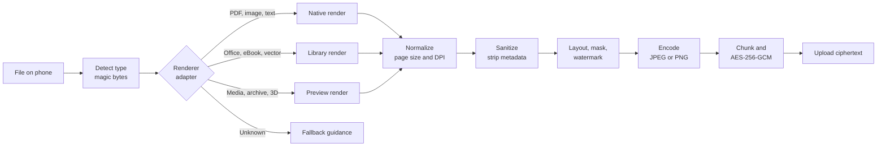

# Despawn: File format support

## Verdict

**Despawn works with every file format that can be turned into pixels, and gives an honest fallback for the rest.**

The rule is simple: the owner's phone converts whatever the file is into page images, and only those images are encrypted and sent. The shop viewer therefore never needs to understand a file format. It only ever shows images. A format is supported if some renderer can draw it.

Three consequences you should know about:

1. **Support is a spectrum, not a yes/no.** Formats are labelled with a fidelity level (below). A PDF or JPEG prints exactly. A DOCX prints approximately unless the optional full-fidelity engine is loaded.
2. **Formats with no visual form cannot be printed in any meaningful way** (executables, databases, disk images, encrypted blobs). Despawn says so and offers a fallback.
3. **Video and audio are not printable.** For those, Despawn prints a frame, a contact sheet or a metadata card. A future view-only mode (Phase 5) could stream video to the shop screen under the same approval model, but it cannot stop screen recording.

## Why rasterize everything

| Reason | Detail |
|---|---|
| Security | Page images carry no macros, scripts, forms, embedded files, hidden text or metadata. The shop never gets anything executable or searchable. |
| Uniform shop viewer | One tiny viewer (under 100 KB) works on any old PC, with no WebAssembly and no format libraries. |
| Deterministic print | What the owner previews is what prints, including the watermark. |
| Privacy | All conversion happens on the owner's phone. The server and the shop never see the original file. |

Cost of the approach: no selectable text on the shop side (a feature, not a bug), larger payloads than a vector PDF, and conversion quality depends on the renderer.

## Fidelity levels

| Level | Meaning | Example |
|---|---|---|
| **L1 Exact** | Native or authoritative renderer. | PDF, JPEG, PNG |
| **L2 High** | Mature library, small differences possible. | HEIC, TIFF, PSD, XLSX tables |
| **L3 Approximate** | Layout may differ from the original app. A preview is shown before locking. | DOCX, PPTX, ODT, HTML, EPUB |
| **L4 Preview only** | A representative page or frame, not the whole content. | Video frame, audio card, archive listing, font specimen, 3D snapshot |
| **L5 Unsupported** | No meaningful visual form. | EXE, DLL, SQLite, disk images, encrypted blobs |

## Pipeline



Each renderer adapter implements one interface:

```ts
interface RenderAdapter {
  id: string;
  fidelity: 'L1' | 'L2' | 'L3' | 'L4';
  canHandle(sniff: Sniff): boolean;                 // magic bytes + mime hint
  open(file: File, opts: OpenOptions): Promise<Doc>; // may ask for a password
  pageCount(doc: Doc): number;
  renderPage(doc: Doc, index: number, target: Raster): Promise<ImageBitmap>;
  dispose(doc: Doc): void;
}
```

All adapters run inside a Web Worker with no network access. Pages are rendered one at a time so memory stays bounded.

## Support matrix

Renderer names are **candidates to validate in Phase 0**. Check current versions and licenses before adopting.

### Documents

| Format | Renderer (candidate) | Level | Phase | Notes |
|---|---|---|---|---|
| PDF | pdf.js | L1 | P1 | Password prompt supported (for example e-PAN PDFs). Annotations and form fields flattened. Disable scripting. |
| DOCX | docx-preview or mammoth.js | L3 | P2 | Fonts that are not installed fall back, so pagination can differ. |
| DOC, ODT, RTF | rtf.js for RTF, full-fidelity engine for DOC and ODT | L3 | P2 / P3 | Legacy binary formats need the optional engine. |
| Markdown, TXT | marked plus sanitizer, monospaced text layout | L1 | P2 | Print stylesheet, syntax highlighting for code. |
| HTML | Sandboxed frame without scripts, rasterized | L3 | P2 | No external resources are fetched. |
| EPUB | epub.js | L3 | P3 | DRM-protected books are unsupported. |

### Spreadsheets

| Format | Renderer (candidate) | Level | Phase | Notes |
|---|---|---|---|---|
| XLSX, XLS, ODS | SheetJS community edition to a paginated table | L3 | P2 | Charts and conditional formatting may be missing. Print areas respected where present. |
| CSV, TSV | Built-in table renderer | L1 | P2 | Column width and page-fit options. |

### Presentations

| Format | Renderer (candidate) | Level | Phase | Notes |
|---|---|---|---|---|
| PPTX, PPT, ODP | Light in-browser renderer (evaluate) or the full-fidelity engine | L3 | P2 / P3 | Animations and embedded video are ignored. The light renderers are the weakest link, so Phase 0 should measure them. |

### Images and photos

| Format | Renderer (candidate) | Level | Phase | Notes |
|---|---|---|---|---|
| JPEG, PNG, WebP, GIF, BMP | Browser decoders | L1 | P1 | Animated GIF prints the first frame. |
| AVIF | Browser decoder | L1 | P1 | Depends on browser support. Falls back to a WASM decoder. |
| SVG | Rendered as an image only, so scripts never run | L1 | P1 | External references blocked. |
| HEIC, HEIF | libheif-js or heic2any | L2 | P2 | Common on iPhone. Safari decodes natively. |
| TIFF (multi-page) | UTIF.js | L2 | P2 | |
| PSD | ag-psd flattened composite | L2 | P3 | Uses the embedded composite when available. |
| RAW (CR2, NEF, ARW, DNG) | Extract the embedded JPEG preview | L4 | P3 | Full RAW development is out of scope. Confirm preview extraction in Phase 0. |
| ICO | Browser decoder | L1 | P1 | |

### Vector, design and CAD

| Format | Renderer (candidate) | Level | Phase | Notes |
|---|---|---|---|---|
| AI | Treated as PDF when PDF-compatible | L2 | P3 | |
| EPS, PS | Ghostscript WASM as an optional plugin | L2 | P3 | Ghostscript is AGPL, so it ships as a separate plugin. |
| DXF | dxf-viewer (three.js) | L2 | P3 | |
| DWG | LibreDWG WASM as an optional plugin | L3 | P4 | GPL plugin. |
| STL, OBJ, GLTF | three.js snapshot | L4 | P3 | Owner picks the camera angle. |

### Archives

| Format | Renderer (candidate) | Level | Phase | Notes |
|---|---|---|---|---|
| ZIP | fflate | L4 | P3 | Lists contents, owner picks a file, which is then processed by its own adapter. |
| 7z, RAR, TAR | libarchive WASM | L4 | P3 | Decompression-bomb limits apply. |

### Media

| Format | Renderer (candidate) | Level | Phase | Notes |
|---|---|---|---|---|
| MP4, WebM, MOV, MKV, AVI | HTMLVideoElement frame grab, ffmpeg.wasm (LGPL build) for other codecs | L4 | P3 | Pick one or more frames, or a contact sheet. |
| MP3, WAV, FLAC, M4A | Cover art and metadata card, waveform | L4 | P3 | Low practical value, included for completeness. |

### Other

| Format | Renderer (candidate) | Level | Phase | Notes |
|---|---|---|---|---|
| TTF, OTF, WOFF | FontFace API specimen sheet | L4 | P3 | |
| Source code, JSON, XML, YAML, logs | Text renderer with highlighting | L1 | P2 | |
| EXE, DLL, ISO, DB, encrypted blobs, unknown binaries | None | L5 | n/a | Offer a file info card (name, size, hash) or the fallback below. |

## Universal fallback

If a format is not in the table, or renders badly:

1. Open the file on the phone in any app that can show it.
2. Use the system **Print**, then **Save as PDF** (Android and iOS both have this), or take a screenshot.
3. Import that PDF or image into Despawn.

This covers any format the phone itself can display, which is effectively every format a person would want to print. Despawn shows this guidance whenever it hits L5 or a render error.

On Android, installing the PWA also adds Despawn to the share sheet, so step 3 becomes "Share, then Despawn". iOS Safari does not support share targets for PWAs, so iOS uses the file picker.

## Limits and resource model

| Setting | Default | Why |
|---|---|---|
| Pages per session | 50 | Print decode memory on old shop PCs. |
| Ciphertext size | 25 MB | Relay cost and abuse control. Configurable by self-hosters. |
| Render DPI | 200 (A4: 1654 × 2339 px), 300 for ID cards | Balance of print quality and size. |
| Phone memory | One page at a time, 300 MB peak | Mid-range Android devices. |
| Shop low-memory mode | 150 DPI | Automatic if the viewer detects a memory error. |
| Parse time per file | 60 s | Stops runaway renderers. |

## Security rules for renderers

- Everything parses in a dedicated Worker with no network access and a hard time and memory budget.
- Decompression limits on every archive-like input (ratio and total size), including DOCX, XLSX, PPTX and EPUB, which are ZIP containers.
- PDF: scripting and eval disabled, external links not followed.
- SVG: rendered as an `` from a blob so scripts and external loads do not run.
- HTML: rendered in a sandboxed frame with scripting and network disabled, then rasterized.
- Passwords for protected files stay in memory only and are cleared after rendering.
- Fuzz the adapters in CI with a malformed-file corpus.

## Optional full-fidelity engine

For Office documents where layout matters, two optional routes exist:

| Route | Pros | Cons |
|---|---|---|
| LibreOffice compiled to WebAssembly, loaded on demand | Fully on-device, so the privacy model is unchanged. | Large download, slow first start. |
| Self-hosted converter service (for example Gotenberg) | Best fidelity, fast. | The server sees the plaintext. Only acceptable on an instance the owner runs and trusts. Off by default and clearly labelled in the UI. |

## Test corpus

Maintain `e2e/corpus/` with at least: password-protected PDF, scanned PDF, 100-page PDF, rotated and EXIF-oriented JPEG, HEIC from an iPhone, multi-page TIFF, DOCX with tables and images, XLSX with merged cells, PPTX with shapes, SVG with a script, a ZIP bomb, a truncated PDF, a file with a wrong extension. Each has an expected fidelity level and a pass/fail rule.
