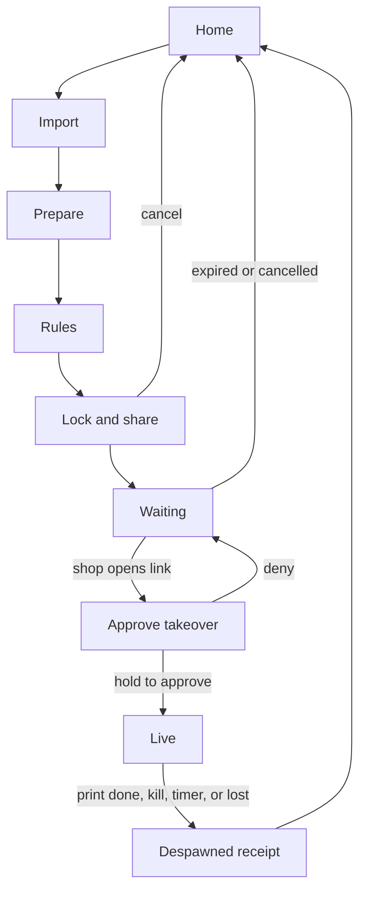

# Despawn: UI design

Version 0.1 (draft). Tokens live in [`design/tokens.css`](../design/tokens.css). Logos live in [`assets/logo/`](../assets/logo/).

## 1. Concept

Despawn borrows from roguelikes, where a thing exists for one life and is gone when it ends. The interface looks like a dark amber terminal HUD:

- The **life bar** is the timer. It drains while a document is visible.
- The **dissolve** is the one memorable moment: when a session ends, the page breaks into amber pixels and leaves.
- Everything else stays quiet, because the product's job is to be trusted at a busy counter, not to be playful.

Two audiences, two registers:

| Surface | Who | Register |
|---|---|---|
| Owner app (phone) | The owner, under mild time pressure | Calm, terse, one decision per screen. Game flavour only in non-critical moments. |
| Shop viewer (PC) | A shopkeeper who did not choose this tool | Plain, large, bilingual, no jokes. It must look trustworthy and obvious. |

## 2. Design plan and review

### 2.1 Plan

| Axis | Decision |
|---|---|
| **Colour** | Soot `#1A140D` (background), Char `#251D13` (surfaces), Parchment `#F2E6CE` (text), Dust `#B8A98A` (secondary text), Amber `#FFB000` (accent), Ember `#FF6B57` (danger). Moss `#8FD18A` for success. Light theme "Paper" `#F7F0E0`. |
| **Type** | JetBrains Mono for UI, controls and numerals. IBM Plex Mono for reading text, help and legal. Noto Sans Devanagari as the Hindi fallback. |
| **Layout** | Mobile: a HUD frame with a status strip on top, one viewport in the middle, and a single command bar at the thumb. Shop viewer: one centred column, large type. Left-aligned text, centred only for the pairing code and status. |
| **Principles** | 1. The timer is a life bar. 2. Loud only for approval and destruction. 3. Structure encodes meaning: borders mark controls, never decoration. 4. Spend boldness in one place, the dissolve. |

### 2.2 Review against defaults

Choices that were revised after checking the plan against common generic outputs:

- A neon green on near-black "hacker" palette was the first instinct. It is a stock look, and the brief (amber terminal) points elsewhere, so the palette is amber phosphor on a warm brown-black.
- Soft rounded cards with grey shadows were replaced by 2 px borders and stepped (notched) corners. Borders appear only where they mark an interactive control or a group boundary.
- No tracked-out all-caps eyebrow labels, no arrows appended to buttons, no numbered decoration. Numbers appear only for real sequences (steps, countdown, code).
- Monospace is the identity here, not a decorative label style, so it carries the whole interface. Two families with clear roles avoid a single flat texture.
- Game motifs were cut back to two: the life bar and the dissolve. No pixel fonts in the UI (the pixel lettering lives in the logo only), which keeps Hindi, accessibility and legibility intact.

## 3. Brand

### 3.1 Name

**Despawn.** In games, an entity despawns when its time or condition ends. That is exactly what happens to the document. Short, memorable, domain-friendly.

Considered and not chosen: Ghostprint (clear but generic, common in other contexts), Permadeath (too dark for ID documents), Vanish (overused), Wisp (vague).

Before publishing: check GitHub, npm, domain and trademark availability. A quick search found no project named Despawn doing this, but it was not exhaustive.

**Tagline:** *Your document gets one life.* Alternate for contexts that need plain language: *Print at any shop, keep nothing behind.*

### 3.2 Voice

Short sentences, plain verbs, sentence case. Game flavour is allowed in empty states and the receipt title. It is never used in approval, errors or anything about security. No apologies in errors, no vague errors: say what happened and what to do.

### 3.3 Logo

| Part | Meaning |
|---|---|
| Page | The document |
| Keyhole (cut-out) | Private by design, only the owner has the key |
| Dissolving lower-right corner and drifting pixels | Despawn: the document leaving |
| Pixel wordmark, last letter losing pixels | The same idea in the name |

Built on a 4-unit pixel grid, drawn as rectangles only, so there is no font dependency and it scales cleanly.

| File | Use |
|---|---|
| `logo-dark.svg` | Horizontal lockup for dark backgrounds, READMEs in dark mode, the app header |
| `logo-light.svg` | Horizontal lockup for light backgrounds |
| `logo-mark.svg` | App icon, 512 × 512, mark inside the maskable safe zone on a Soot tile |
| `favicon.svg` | Browser tab, follows the OS light/dark setting |
| `generate_logo.py` | Regenerates every file. Edit this, not the SVGs |

**Clear space:** two logo pixels (one eighth of the mark's height) on every side.
**Minimum size:** lockup 120 px wide on screen or 30 mm in print. Below that use the mark alone. Mark alone: 16 px, use `favicon.svg`.

**Do not:** recolour outside the palette, add outlines or shadows, smooth or round the pixels, rotate or stretch, place the amber mark on a light background (1.6:1 contrast, use `logo-light.svg`), or animate it other than with the defined dissolve.

**Other assets to produce at build time:** PWA icons 192 and 512 (plus maskable), Apple touch icon 180, social preview 1200 × 630 (lockup on Soot with the tagline), and a monochrome mark for notifications.

## 4. Tokens

### 4.1 Colour and contrast (checked)

Dark theme (default):

| Role | Token | Hex | Contrast |
|---|---|---|---|
| Text on background | `--parchment` on `--soot` | `#F2E6CE` on `#1A140D` | 14.8:1 |
| Text on surface | `--parchment` on `--char` | `#F2E6CE` on `#251D13` | 13.4:1 |
| Secondary text | `--dust` on `--soot` / `--char` | `#B8A98A` | 7.9:1 / 7.2:1 |
| Accent as text or icon | `--amber` on `--soot` / `--char` | `#FFB000` | 10.0:1 / 9.1:1 |
| Primary button label | `--soot` on `--amber` | | 10.0:1 |
| Danger text or icon | `--ember` on `--soot` / `--char` | `#FF6B57` | 6.5:1 / 5.9:1 |
| Danger button label | `--soot` on `--ember` | | 6.5:1 |
| Success | `--moss` on `--soot` / `--char` | `#8FD18A` | 10.1:1 / 9.2:1 |
| Control border | `--line-strong` on `--soot` / `--char` | `#8A7550` | 4.1:1 / 3.7:1 (needs 3:1) |
| Decorative divider | `--ash` on `--soot` | `#3B2F20` | 1.4:1, never used to identify a control |

Paper theme (light): text `#1A140D` on `#F7F0E0` 16.1:1, secondary `#6B5B3F` 5.8:1, accent text `#8A5A00` 5.2:1, danger `#B3321F` 5.5:1, success `#276B31` 5.7:1. The primary button stays amber with ink text.

Colour is never the only signal. Every status also has text or an icon.

### 4.2 Type scale

| Token | Size | Use |
|---|---|---|
| `--fs-code` | 56 px, weight 800 | Pairing code |
| `--fs-2xl` | 36 px | Screen titles on desktop, big countdown |
| `--fs-xl` | 26 px | Screen titles on mobile |
| `--fs-lg` | 20 px | Section headings |
| `--fs-md` | 16 px | Body (IBM Plex Mono, line-height 1.55) |
| `--fs-sm` | 14 px | Secondary text, captions |
| `--fs-xs` | 12 px | Fine print only |

Line length stays under 70 characters. Digits use `font-variant-numeric: tabular-nums`. Hindi text uses the fallback font and must never depend on fixed-width columns.

### 4.3 Space, shape, motion

- 4 px spacing grid. Touch targets at least 48 px.
- Shape: no border-radius. Corners use a 4 px stepped cut (`.notch`). Borders are 2 px.
- Motion: 120 ms for taps, 200 ms for transitions, 640 ms for the dissolve with `steps(8)` easing. All motion reduces to zero under `prefers-reduced-motion`.

## 5. Components

| Component | Behaviour and anatomy |
|---|---|
| **Button, primary** | Amber fill, Soot label, notched. Pressed: one-step inset. |
| **Button, secondary** | 2 px `--line-strong` border, text colour. |
| **Button, danger** | Ember fill. Used only for Destroy now and Deny. |
| **Hold to approve** | Fills left to right over 1 second. Haptic tick at the halfway point and a double pulse on commit. Releasing early cancels. Keyboard: hold Space or Enter. |
| **Life bar** | 20 segments, each is 5% of the live time. Drains with stepped motion. Amber, switching to Ember at 25% or less. Always shows the remaining time as text. Announces at 60, 30 and 10 seconds via `aria-live="polite"`. |
| **Code display** | Four digits, 56 px, wide letter-spacing, in a notched frame. `aria-label="Code 4 8 2 1"`. Identical on phone and shop screen so they can be compared at a glance. |
| **Status chip** | Icon plus text: Waiting, Viewing, Printing, Destroyed, Expired, Revoked. Sentence case. |
| **File card** | Type badge, file name, page count, size, fidelity label (Exact copy, High fidelity, Approximate layout, Preview only). |
| **Page strip** | Horizontal thumbnails with the watermark visible, tap to select, long-press to reorder. |
| **Segmented control** | Used for layout, paper size, timers. At least 48 px tall. |
| **Slider** | 48 px thumb area, value shown as text. |
| **Toggle** | Label on the left, state text ("On", "Off") beside the switch. |
| **Bottom sheet** | Used for pickers and help, never for the approval flow. |
| **Takeover** | Full screen, reserved for the approval request. Blocks other taps. |
| **Receipt** | Ticket-style list with a divider, checks and a footnote. |
| **Toast** | Bottom, 4 seconds, never covers the Destroy button. |
| **QR panel** | Black on white tile with a 4-module quiet zone, regardless of theme. |
| **Empty state** | One sentence and one action. |

## 6. Flow



## 7. Owner app screens

Wireframes are layout intent, not final pixels. Mobile baseline: 360–430 px wide, with bottom safe-area padding.

### O1. Welcome (first run, three cards)

1. *Send a link, not a file.* The shop never gets your document.
2. *You approve every print.* Your phone is the only key.
3. *Then it despawns.* The page wipes itself when you say, when it prints, or when time runs out.

A single **Get started** button. A small link to "How this works" opens the threat summary. No account step.

### O2. Home

```
┌────────────────────────────────────┐
│ [mark] despawn                  ⚙  │
├────────────────────────────────────┤
│                                    │
│ ┌────────────────────────────────┐ │
│ │                                │ │
│ │        + New print job         │ │
│ │   PDF, images, Office, more    │ │
│ │                                │ │
│ └────────────────────────────────┘ │
│                                    │
│ Recent                             │
│ ┌────────────────────────────────┐ │
│ │ SIM verification       11 Nov  │ │
│ │ 1 page printed, destroyed      │ │
│ └────────────────────────────────┘ │
│ ┌────────────────────────────────┐ │
│ │ Bank KYC               09 Nov  │ │
│ │ Expired, never opened          │ │
│ └────────────────────────────────┘ │
│                                    │
│ Tip: share a file from WhatsApp to │
│ Despawn to start a job.            │
└────────────────────────────────────┘
```

Empty state for Recent: "Nothing here yet. Start a job and its receipt will show up here."

### O3. Import (step 1 of 4)

```
┌────────────────────────────────────┐
│ ‹ Back       New print job  1 of 4 │
├────────────────────────────────────┤
│ ┌────────────────────────────────┐ │
│ │ [PDF]  e-PAN.pdf               │ │
│ │ 1 page, 84 KB                  │ │
│ │ Exact copy                     │ │
│ └────────────────────────────────┘ │
│                                    │
│ This PDF is password protected.    │
│ ┌────────────────────────────────┐ │
│ │ Password                       │ │
│ └────────────────────────────────┘ │
│ The password stays on this phone.  │
│                                    │
│ [        Open and continue       ] │
└────────────────────────────────────┘
```

Variants: *approximate layout* shows a note "Layout may differ from the original. You will see a preview next." *Unsupported* shows "Despawn can't draw this file type." with the fallback steps from FILE_SUPPORT.md and a **Choose another file** button.

### O4. Prepare (step 2 of 4)

```
┌────────────────────────────────────┐
│ ‹ Back          Prepare       2 of 4│
├────────────────────────────────────┤
│        ┌────────────────┐          │
│        │  page preview  │          │
│        │  with the      │          │
│        │  watermark, as │          │
│        │  it will print │          │
│        └────────────────┘          │
│          ‹  page 1 of 1  ›         │
├────────────────────────────────────┤
│ Layout | Mask | Mark | Colour      │
│                                    │
│ Paper   (A4) (A5) (Letter)         │
│ Layout  (Full) (Fit) (ID card)     │
│         (Two per page)             │
│ ID card prints at actual size,     │
│ front and back on one sheet.       │
├────────────────────────────────────┤
│ [           Continue             ] │
└────────────────────────────────────┘
```

**Mark tab:**

```
│ Purpose  [ SIM verification     ▾ ]│
│ Stamp    (Watermark) (Self-attested)│
│ Density  ───●────────────          │
│ Opacity  ──────●─────────          │
│ Preview updates as you change.     │
```

**Mask tab** (v0.2): drag to draw boxes, choose Black or Blur, undo. **Colour tab:** Colour, Greyscale, Black and white, brightness and contrast.

### O5. Rules (step 3 of 4)

```
┌────────────────────────────────────┐
│ ‹ Back             Rules      3 of 4│
├────────────────────────────────────┤
│ Link works for                     │
│ (5 min) (30 min) (2 h) (24 h)      │
│                                    │
│ Visible after you approve          │
│ (1 min) (2 min) (5 min)            │
│                                    │
│ Prints allowed        [ − ] 1 [ + ]│
│ Destroy right after print   On  [●]│
│ Verification QR on the copy Off [ ]│
├────────────────────────────────────┤
│ [       Lock and continue        ] │
└────────────────────────────────────┘
```

"Verification QR" shows a one-line explainer: "Lets someone scan the copy to see if it is still valid."

### O6. Lock and share (step 4 of 4)

Locking state:

```
│ Locking your document              │
│ Page 1 of 1                        │
│ ████████████████░░░░  80%          │
│ Encrypted on this phone. The       │
│ server only gets scrambled data.   │
```

Ready state:

```
┌────────────────────────────────────┐
│ ‹ Back          Share         4 of 4│
├────────────────────────────────────┤
│ Ready. Send this link to the shop. │
│                                    │
│ ┌──────────┐  despawn.app/s/7F3A…  │
│ │ QR code  │                       │
│ └──────────┘                       │
│ [  Share link  ]   [   Copy   ]    │
│                                    │
│ The link holds no file. It only    │
│ works while you approve it live.   │
│ Valid for 30 min.                  │
│                                    │
│ [ Cancel session ]                 │
└────────────────────────────────────┘
```

Share sends only the link (WhatsApp, SMS, anything). The QR is for opening the link on a shop PC with a phone camera on the same screen, or typing the short URL.

### O7. Waiting

```
┌────────────────────────────────────┐
│ Session 7F3A         ● Connected   │
├────────────────────────────────────┤
│                                    │
│            (  (  ·  )  )           │
│                                    │
│  Waiting for the shop to open      │
│  the link.                         │
│                                    │
│  Link expires in 28:41             │
│                                    │
│ [ Cancel session ]                 │
└────────────────────────────────────┘
```

The ring pulse is the only idle animation, 2 seconds per cycle, disabled under reduced motion.

### O8. Approve (takeover)

```
┌────────────────────────────────────┐
│ Someone opened your link           │
│                                    │
│ Chrome on Windows                  │
│ Region, Country · 11 Nov 14:31     │
│                                    │
│ Does the shop screen show this     │
│ code?                              │
│                                    │
│          ┌──────────────┐          │
│          │   4 8 2 1    │          │
│          └──────────────┘          │
│                                    │
│ [   Deny   ]  [ Hold to approve ]  │
│                                    │
│ If the code is different, or the   │
│ shop screen shows nothing, deny.   │
└────────────────────────────────────┘
```

With two or more requests, the screen lists each (browser, OS, code, time). Approving one denies the rest, and the list says so. The takeover cannot be dismissed by tapping outside it.

### O9. Live

```
┌────────────────────────────────────┐
│ Session 7F3A       Shop connected  │
├────────────────────────────────────┤
│ Visible for                        │
│ ████████████░░░░░░░░  1:12         │
│                                    │
│ Status        Viewing              │
│ Prints        0 of 1               │
│                                    │
│ Keep this screen open until it     │
│ finishes.                          │
│                                    │
│ ┌────────────────────────────────┐ │
│ │          Destroy now           │ │
│ └────────────────────────────────┘ │
└────────────────────────────────────┘
```

Destroy now is full width, Ember, always at the thumb. One tap, no confirmation, because speed matters more than preventing accidents here. Status text changes to Printing and Printed as the shop reports them.

### O10. Despawned (receipt)

```
┌────────────────────────────────────┐
│ Despawned                          │
│ Session 7F3A                       │
│ ────────────────────────────────── │
│ Created         14:29              │
│ Approved        14:31  Chrome, Win │
│ Pages printed   1                  │
│ Destroyed       14:32:08           │
│                 Print finished     │
│ ────────────────────────────────── │
│ ✓ Server copy deleted              │
│ ✓ Key erased on this phone         │
│ ✓ Shop page reported its wipe *    │
│                                    │
│ * Reported by the shop page itself,│
│   so it can't be independently     │
│   verified.                        │
│                                    │
│ [ Revoke copy ]       [   Done   ] │
└────────────────────────────────────┘
```

The dissolve plays once as this screen appears, over a placeholder (the live document is already gone). "Revoke copy" appears only when a verification QR was printed.

### O11. History

List of local receipts: purpose label, date, final state chip (Destroyed, Expired, Cancelled, Revoked), tap for the receipt. Footer: "Receipts are stored on this phone only." Actions: Export, Delete all.

### O12. Settings

| Group | Items |
|---|---|
| General | Language (English, हिन्दी), Theme (Dark, Paper, Match system) |
| Defaults | Purpose, link validity, visible time, destroy after print |
| Feedback | Haptics (On), Sound (Off) |
| Server | Relay address (default public instance), Test connection |
| About | How it works, Threat summary, Open-source licenses, Version, Source code |

### O13. Edge and error states

| Situation | Message | Action |
|---|---|---|
| Phone offline during a live session | "You're offline. The shop page wipes itself in a few seconds." | Retry connection |
| Link expired | "This link expired before the shop opened it." | New session |
| Request denied | "You denied the request. The shop sees nothing." | Wait for another or cancel |
| Code mismatch reported by owner | Deny flow | |
| Upload failed | "Couldn't upload. Your document is still only on this phone." | Retry |
| File too large | "This is over 50 pages. Remove some pages or split the file." | Edit pages |
| Render failed | "Despawn couldn't draw this file." plus fallback steps | Choose another file |
| Relay unreachable | "Can't reach the server at [address]." | Check address, retry |

## 8. Shop viewer screens (desktop)

Plain, large, bilingual. Default language follows the browser, with an always-visible toggle. Layout is a single centred column up to 720 px. Type is at least 20 px for instructions. No decoration beyond the logo, the code and the life bar.

### V1. Waiting for approval

```
┌──────────────────────────────────────────┐
│ [mark] despawn          [ English | हिन्दी ]│
│                                          │
│   Waiting for the owner to approve       │
│                                          │
│   The owner's phone should show this     │
│   code:                                  │
│                                          │
│               4 8 2 1                    │
│                                          │
│   Ask the owner to check the code and    │
│   tap Approve on their phone.            │
└──────────────────────────────────────────┘
```

### V2. Preparing

"Approved. Preparing the document." with a segmented progress bar. If this takes longer than 15 seconds, add "Slow connection. Still working."

### V3. Ready to print

```
┌──────────────────────────────────────────┐
│ Approved by the owner     Visible for 1:48│
│                           ████████░░░░    │
│ ┌──────────────────────────────────────┐ │
│ │                                      │ │
│ │   page 1 of 1                        │ │
│ │   (watermarked preview)              │ │
│ │                                      │ │
│ └──────────────────────────────────────┘ │
│                                          │
│   1. Press Print.                        │
│   2. Choose your printer.                │
│                                          │
│ [               Print                  ] │
│                                          │
│ This page destroys itself after          │
│ printing.                                │
└──────────────────────────────────────────┘
```

Multiple pages show a vertical scroll. A help link, "Print window didn't open?", expands to: allow pop-ups for this site, or press Ctrl+P.

### V4. Printing

"Sending to printer. Take the pages from the tray." The Print button is disabled. If `afterprint` does not fire, the timer fallback moves to V5.

### V5. Destroyed

```
┌──────────────────────────────────────────┐
│                                          │
│   Destroyed.                             │
│   This page no longer has the document.  │
│                                          │
│   You can close this tab.                │
└──────────────────────────────────────────┘
```

Reasons are shown in plain words: "Printed", "The owner ended the session", "Time ran out", "Connection to the owner was lost". The wipe always happens before this screen renders. Animation never delays it.

### V6. Link not valid

"This link has expired or was already used. Ask the owner for a new link." Same screen for unknown IDs, so link validity is not leaked.

### V7. Browser not supported

"This browser is too old to open the document securely. Open this link in Chrome, Edge or Firefox." Shown when WebCrypto or required APIs are missing. No partial rendering.

## 9. Verification page (recipient)

Public, minimal, no account.

```
┌──────────────────────────────────────────┐
│ [mark] despawn                           │
│                                          │
│   ✓ Valid copy                           │
│                                          │
│   Purpose     SIM verification           │
│   Printed     11 Nov 2026                │
│   Reference   7F3A                       │
│                                          │
│   This page confirms the copy was        │
│   printed through Despawn for the stated │
│   purpose. It does not verify identity.  │
└──────────────────────────────────────────┘
```

States: **Valid copy**, **Revoked by the owner** (Ember), **Expired**, **Not found**. The page never shows names, numbers or any document content. The disclaimer is mandatory.

## 10. Motion, sound, haptics

| Moment | Treatment |
|---|---|
| Despawn dissolve | The visible block breaks into 8 × 8 px squares that fade out in 8 steps over 640 ms, staggered from the lower-right corner, drifting up and right. Plays on the owner receipt. On the shop viewer, only over a placeholder after the wipe. Never delays a wipe. |
| Life bar | Segments drop in steps, not smooth fades. |
| Hold to approve | Progress fill, haptic tick at half, double pulse on commit. |
| Waiting | Single ring pulse. |
| Reduced motion | Dissolve becomes an instant swap. Pulse becomes static. Bar drains without animation. |
| Haptics | Approve: two short pulses. Deny: one. Destroy: one long pulse (80 ms). |
| Sound | Off by default. If enabled, a short soft blip on approve and a four-note descending sound on despawn. |

## 11. Copy

### 11.1 Rules

- Say what the user can do. Same name for the same action everywhere: *Approve*, *Deny*, *Destroy now*, *Despawned*.
- Do not overclaim. The shop screen says the page "no longer has the document", never "nothing was saved anywhere".
- No jokes in approval, errors or security text.

### 11.2 Key strings

| Key | English | Hindi (needs native review) |
|---|---|---|
| viewer.waiting | Waiting for the owner to approve | फ़ाइल के मालिक की मंज़ूरी का इंतज़ार है |
| viewer.code | The owner's phone should show this code | मालिक के फ़ोन पर यही कोड दिखना चाहिए |
| viewer.step1 | Press Print. | Print दबाएँ। |
| viewer.step2 | Choose your printer. | अपना प्रिंटर चुनें। |
| viewer.selfdestroy | This page destroys itself after printing. | प्रिंट के बाद यह पेज अपने आप मिट जाएगा। |
| viewer.destroyed | Destroyed. This page no longer has the document. | मिटा दिया गया। अब इस पेज में दस्तावेज़ नहीं है। |
| viewer.expired | This link has expired or was already used. | यह लिंक समाप्त हो गया है या पहले इस्तेमाल हो चुका है। |
| owner.approve | Hold to approve | मंज़ूरी के लिए दबाए रखें |
| owner.deny | Deny | मना करें |
| owner.destroy | Destroy now | अभी मिटाएँ |
| owner.despawned | Despawned | मिटा दिया गया |

## 12. Accessibility

- WCAG 2.2 AA throughout, with contrast values listed above.
- Minimum 48 px targets. The Destroy button and the approval controls are never smaller or closer than 16 px to another action.
- Every control has a visible focus style (2 px amber or amber-ink outline). Full keyboard operation on desktop, including hold-to-approve with Space.
- Screen readers: the code is read digit by digit, the life bar exposes `role="progressbar"` with text, state changes use `aria-live`, and the takeover is a modal dialog with focus trapped.
- Reduced motion, system text scaling up to 200%, and high-contrast preference respected.
- Hindi and English at launch. Layouts tolerate longer strings, and no fixed-width columns for text.
- Colour never carries meaning alone.

## 13. Responsive and platform notes

| Context | Notes |
|---|---|
| Phone, portrait | Primary target, 360–430 px. Command bar at the bottom within thumb reach. |
| Phone, landscape | Preview left, controls right. Approve and Destroy keep full width in their own area. |
| Tablet and desktop owner | Centred 480 px column. Drag and drop import. |
| Shop viewer | Desktop-first, responsive down to 360 px for phone-as-terminal cases. |
| iOS | No share target. Approval screen must be in the foreground. Show this in onboarding. |
| Installed PWA | Standalone display, Soot status bar, safe-area insets respected. |

## 14. Handoff

- This document and `design/tokens.css` are the source of truth. Components are built once in `packages/ui` and shared by the owner app and the viewer.
- Wireframes show structure and copy. Final spacing follows the 4 px grid and the tokens.
- Add Storybook or a similar catalogue once components exist, with one story per state above.
- Screenshot tests (Playwright) for every screen in dark and Paper themes, English and Hindi.
